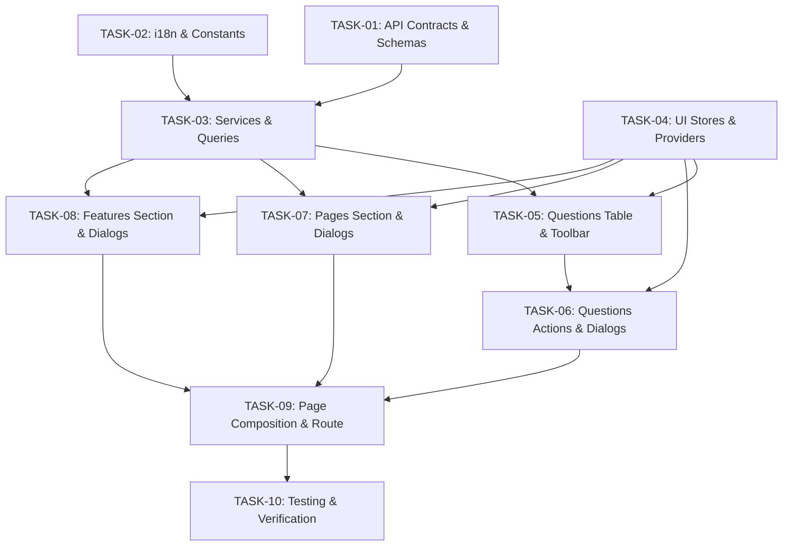

# Support Questions Parity & Implementation Tasks

This directory defines the component-by-component implementation breakdown for `/support-questions/` in `iap-admin`, ported from reference implementation `insurance-ui`.

## Source of Truth
- **Reference Route:** `insurance-ui/src/routes/_authenticated/support-questions/index.tsx`
- **Reference Feature:** `insurance-ui/src/features/support-questions/`
- **Reference Constants:** `insurance-ui/src/constants/tickets-constant.ts` & `insurance-ui/src/constants/party-constant.ts`
- **Reference Translations:** `insurance-ui/src/locales/fa.json` & `en.json` (`supportQuestions.*`, `supportPages.*`, `supportFeatures.*`)
- **Reference OpenAPI:** `insurance-ui/openapidoc.json` (`/api/support/questions/**`, `/api/support/pages/**`, `/api/support/features/**`)
- **Target Route:** `apps/iap-admin/src/app/router/routes/_authenticated/support-questions/index.tsx`
- **Target Feature:** `apps/iap-admin/src/features/support-questions/`
- **Target Contracts:** `packages/api-types/src/support/`
- **Target Constants:** `apps/iap-admin/src/features/support-questions/constants/support-question-constant.ts`

## Component & Structure Mapping

| Reference Component / File | Target Component / File | Architecture Role |
| --- | --- | --- |
| `src/features/support-questions/data/support-question-schema.ts` | `packages/api-types/src/support/index.ts` & `features/support-questions/model/` | Question schemas, API contracts & form schema |
| `src/features/support-questions/data/support-page-schema.ts` | `packages/api-types/src/support/index.ts` & `features/support-questions/model/` | Page schemas, API contracts & form schema |
| `src/features/support-questions/data/support-feature-schema.ts` | `packages/api-types/src/support/index.ts` & `features/support-questions/model/` | Feature schemas, API contracts & form schema |
| `src/constants/tickets-constant.ts` & `party-constant.ts` | `features/support-questions/constants/support-question-constant.ts` | Enum constants, input displays, colors & option getters |
| `src/features/support-questions/services/support-question-service.ts` | `features/support-questions/services/support-question-service.ts` | Typed backend API calls with `@iap/api-client` & `@iap/shared-lib` |
| `src/features/support-questions/services/support-page-service.ts` | `features/support-questions/services/support-page-service.ts` | Typed backend API calls with `@iap/api-client` & `@iap/shared-lib` |
| `src/features/support-questions/services/support-feature-service.ts` | `features/support-questions/services/support-feature-service.ts` | Typed backend API calls with `@iap/api-client` & `@iap/shared-lib` |
| `src/features/support-questions/context/support-question-context.tsx` | `features/support-questions/context/store/support-question-store.ts` & `provider/` | Zustand store for question dialogs & selection, plus cleanup provider |
| `src/features/support-questions/context/support-page-context.tsx` | `features/support-questions/context/store/support-page-store.ts` & `provider/` | Zustand store for page dialogs & cleanup provider |
| `src/features/support-questions/context/support-feature-context.tsx` | `features/support-questions/context/store/support-feature-store.ts` & `provider/` | Zustand store for feature dialogs & cleanup provider |
| `src/features/support-questions/components/support-questions/support-questions-section.tsx` | `features/support-questions/components/support-questions/support-questions-section.tsx` | Main top section: URL filter sync, paginated table, dialog integration |
| `src/features/support-questions/components/support-questions/support-question-columns.tsx` | `features/support-questions/components/support-questions/support-question-columns.tsx` | TanStack Table column definitions using `@shared/tables` TwoLineCell |
| `src/features/support-questions/components/support-questions/support-questions-data-table-toolbar.tsx` | `features/support-questions/components/support-questions/support-questions-data-table-toolbar.tsx` | Search input filters & faceted inputDisplay filter |
| `src/features/support-questions/components/support-questions/support-question-row-actions.tsx` | `features/support-questions/components/support-questions/support-question-row-actions.tsx` | Row actions: view details, edit, delete |
| `src/features/support-questions/components/support-questions/support-question-table-actions.tsx` | `features/support-questions/components/support-questions/support-question-table-actions.tsx` | Table actions: bulk delete, refresh, create question |
| `src/features/support-questions/components/support-questions/support-question-form-dialog.tsx` | `features/support-questions/components/support-questions/support-question-form-dialog.tsx` | Create/edit dialog with typedZodResolver, tags & select controls |
| `src/features/support-questions/components/support-questions/support-question-view-dialog.tsx` | `features/support-questions/components/support-questions/support-question-view-dialog.tsx` | Read-only details view dialog |
| `src/features/support-questions/components/support-questions/support-question-delete-dialog.tsx` | `features/support-questions/components/support-questions/support-question-delete-dialog.tsx` | Single question delete confirmation dialog |
| `src/features/support-questions/components/support-questions/support-question-bulk-delete-dialog.tsx` | `features/support-questions/components/support-questions/support-question-bulk-delete-dialog.tsx` | Bulk question delete confirmation dialog |
| `src/features/support-questions/components/support-questions/support-question-next-selectable-question-keys-field.tsx` | `features/support-questions/components/support-questions/support-question-next-selectable-question-keys-field.tsx` | MultiSelect field with debounced search query |
| `src/features/support-questions/components/support-pages/support-pages-section.tsx` | `features/support-questions/components/support-pages/support-pages-section.tsx` | Bottom left grid: pages table with local pagination & actions |
| `src/features/support-questions/components/support-pages/support-page-columns.tsx` | `features/support-questions/components/support-pages/support-page-columns.tsx` | Pages table column definitions |
| `src/features/support-questions/components/support-pages/support-page-row-actions.tsx` | `features/support-questions/components/support-pages/support-page-row-actions.tsx` | Pages row actions: edit, delete |
| `src/features/support-questions/components/support-pages/support-page-table-actions.tsx` | `features/support-questions/components/support-pages/support-page-table-actions.tsx` | Pages table actions: refresh, create page |
| `src/features/support-questions/components/support-pages/support-page-form-dialog.tsx` | `features/support-questions/components/support-pages/support-page-form-dialog.tsx` | Pages create/edit dialog with Zod validation |
| `src/features/support-questions/components/support-pages/support-page-delete-dialog.tsx` | `features/support-questions/components/support-pages/support-page-delete-dialog.tsx` | Pages delete confirmation dialog |
| `src/features/support-questions/components/support-features/support-features-section.tsx` | `features/support-questions/components/support-features/support-features-section.tsx` | Bottom right grid: features table with local pagination & actions |
| `src/features/support-questions/components/support-features/support-feature-columns.tsx` | `features/support-questions/components/support-features/support-feature-columns.tsx` | Features table column definitions |
| `src/features/support-questions/components/support-features/support-feature-row-actions.tsx` | `features/support-questions/components/support-features/support-feature-row-actions.tsx` | Features row actions: edit, delete |
| `src/features/support-questions/components/support-features/support-feature-table-actions.tsx` | `features/support-questions/components/support-features/support-feature-table-actions.tsx` | Features table actions: refresh, create feature |
| `src/features/support-questions/components/support-features/support-feature-form-dialog.tsx` | `features/support-questions/components/support-features/support-feature-form-dialog.tsx` | Features create/edit dialog with MultiSelect pageKeys |
| `src/features/support-questions/components/support-features/support-feature-delete-dialog.tsx` | `features/support-questions/components/support-features/support-feature-delete-dialog.tsx` | Features delete confirmation dialog |
| `src/features/support-questions/pages/support-questions-page.tsx` | `features/support-questions/support-questions-page.tsx` | Single-root-route page layout: Top questions section + bottom 2-column grid |
| `src/routes/_authenticated/support-questions/index.tsx` | `app/router/routes/_authenticated/support-questions/index.tsx` | Thin TanStack Router route delegating to `SupportQuestionsPage` |

## Task Breakdown & Execution Plan

| Task ID | Document | Scope & Responsibilities | Parallelizable With | Status |
| --- | --- | --- | --- | --- |
| **TASK-01** | [TASK-01-API-CONTRACTS-AND-SCHEMAS.md](./TASK-01-API-CONTRACTS-AND-SCHEMAS.md) | Zod schemas & types in `@iap/api-types/src/support/` and feature models | TASK-02 | Completed |
| **TASK-02** | [TASK-02-LOCALIZATION-AND-CONSTANTS.md](./TASK-02-LOCALIZATION-AND-CONSTANTS.md) | Translations in `common.json` & enum constants | TASK-01 | Completed |
| **TASK-03** | [TASK-03-SERVICES-AND-QUERIES.md](./TASK-03-SERVICES-AND-QUERIES.md) | API client services for questions, pages, features using `@iap/api-client` | - | Completed |
| **TASK-04** | [TASK-04-STORE-AND-STATE-MANAGEMENT.md](./TASK-04-STORE-AND-STATE-MANAGEMENT.md) | Zustand stores & providers under `context/store/` and `context/provider/` | TASK-05 | Completed |
| **TASK-05** | [TASK-05-SUPPORT-QUESTIONS-TABLE-AND-TOOLBAR.md](./TASK-05-SUPPORT-QUESTIONS-TABLE-AND-TOOLBAR.md) | Columns with TwoLineCell, toolbar with faceted filter, and table actions | - | Completed |
| **TASK-06** | [TASK-06-SUPPORT-QUESTIONS-ROW-ACTIONS-AND-DIALOGS.md](./TASK-06-SUPPORT-QUESTIONS-ROW-ACTIONS-AND-DIALOGS.md) | Row actions, Form dialog, View dialog, Delete dialogs & Next-Selectable Keys | - | Completed |
| **TASK-07** | [TASK-07-SUPPORT-PAGES-SECTION.md](./TASK-07-SUPPORT-PAGES-SECTION.md) | Support Pages table section, columns, actions & form/delete dialogs | TASK-08 | Completed |
| **TASK-08** | [TASK-08-SUPPORT-FEATURES-SECTION.md](./TASK-08-SUPPORT-FEATURES-SECTION.md) | Support Features table section, columns, actions & form/delete dialogs | TASK-07 | Completed |
| **TASK-09** | [TASK-09-PAGE-COMPOSITION-AND-ROUTE-INTEGRATION.md](./TASK-09-PAGE-COMPOSITION-AND-ROUTE-INTEGRATION.md) | Page composition, barrel export & route replacement in `iap-admin` | - | Completed |
| **TASK-10** | [TASK-10-TESTING-AND-VERIFICATION.md](./TASK-10-TESTING-AND-VERIFICATION.md) | Unit tests, contract verification, lint, typecheck, build | - | Completed |
| **AUDIT** | [PARITY-AUDIT-DISCREPANCIES.md](./PARITY-AUDIT-DISCREPANCIES.md) | Component-by-component line-by-line parity audit vs reference | - | Completed |

## Dependency Graph

